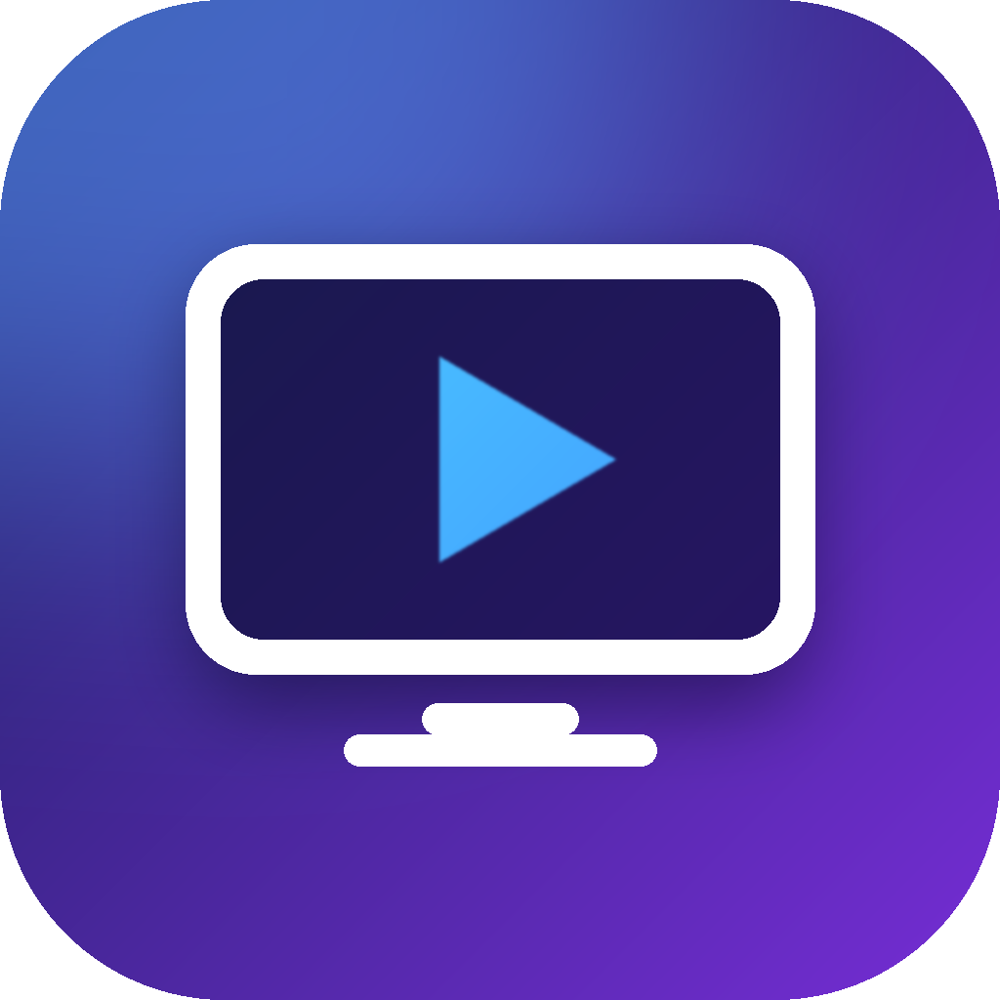
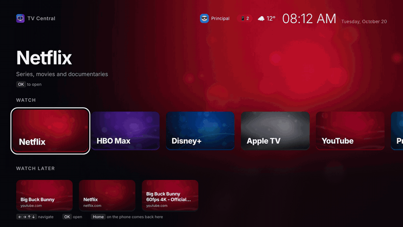
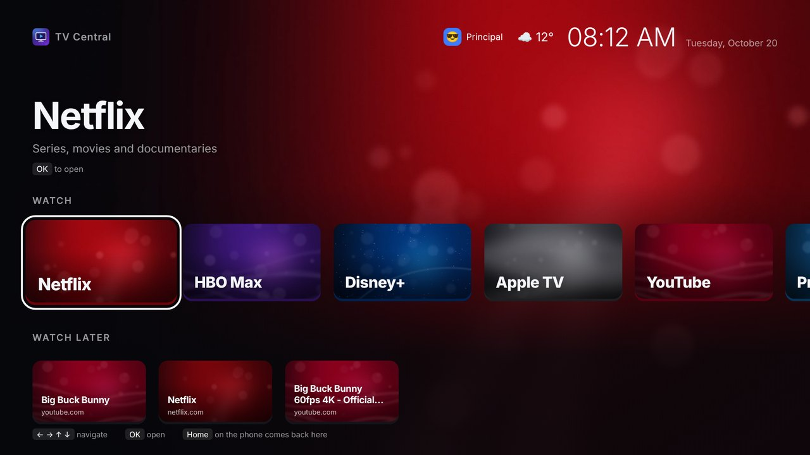
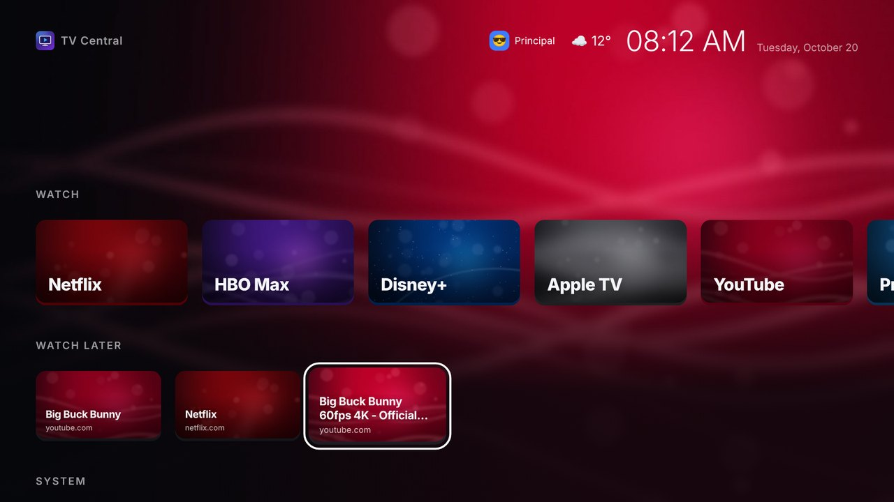
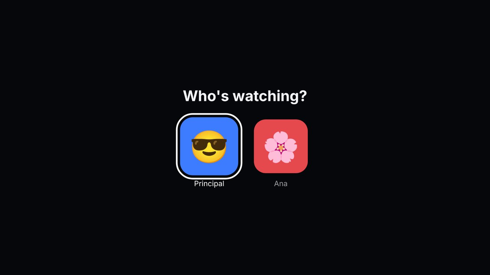
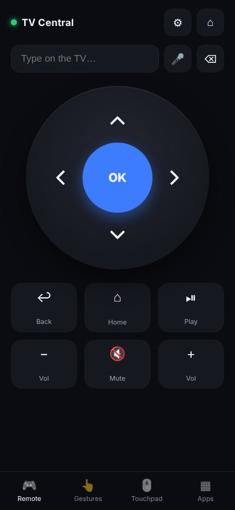
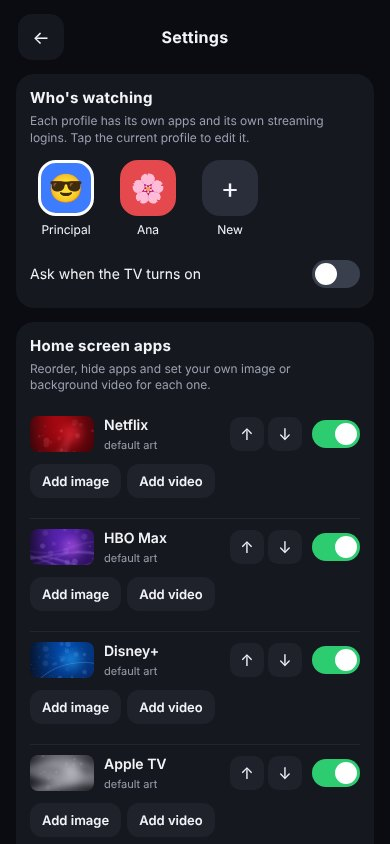

# TV Central

<p align="center"></p>

<p align="center"><b>Turn any Windows PC plugged into a TV into a TV box: no ads, controlled from your phone.</b><br>
<a href="README.pt-BR.md">Português</a> · <a href="../../releases/latest">Download</a></p>

<p align="center"></p>

An old laptop on HDMI makes a great TV box: it already runs Netflix, Disney+, Max, Apple TV, YouTube and any
website, with a better browser than most smart TVs. What it lacks is a TV interface and a remote.
TV Central adds both, in a single 8 MB `.exe`, with no account and nothing to configure.

| | |
|---|---|
|  |  |
| *Home screen with art for every app* | *Watch later, sent from the phone* |
|  |   |
| *Profiles with separate logins* | *Remote and settings on the phone* |

## What you get

**On the TV**
- A full-screen home screen that starts with Windows: big cards, art and ambient colour for each app, clock and weather, and a short intro with its own music.
- **Arrow-key navigation inside the streaming sites.** Netflix, Disney+, Max and Apple TV are built for a mouse; TV Central moves a highlight between posters and buttons, OK opens, Back goes back. YouTube opens in its own TV interface.
- **Ad blocking** in the windows TV Central opens: ad and tracker domains on every site, and YouTube ads stripped before the player sees them. Your everyday browser is not touched.
- **Profiles** ("Who's watching?") with their own apps and their own streaming logins, and a **kids mode** that only shows the apps you allow and needs a PIN to leave.
- **Watch later**, **photos from the phone** as a screensaver or on demand, **phone mirroring** through Windows' *Connect*, a **sleep timer**, background **videos** you pick, and a screensaver that keeps the panel from burning in.
- A **light mode** that turns itself on when the PC can't keep up (tested on Intel HD 3000), and an optional line with CPU, memory and disk.

**On the phone** (open the address shown on the TV, no app store)
- D-pad, OK, back, home, volume and play/pause; a **gestures** pad (swipe to move, tap for OK, hold for back) and a **touchpad**.
- Type and dictate on the TV; the text box clears itself after Enter.
- **Settings panel**: reorder and hide apps, upload your own image or video for each one, add any website as a card, profiles, kids mode, weather city, sounds, language.
- Share a link from Netflix or YouTube on the phone → *TV Central* and it lands in Watch later.

**Behind the scenes**
- Updates itself from GitHub Releases, checks the SHA-256, installs only when nothing is playing and rolls back if the new version fails to start.
- Pairing with a code shown on the TV; tokens are stored hashed. The port is opened to the local network only, and requests from other websites are refused.
- English, Portuguese and Spanish. A single Go binary with the web UI embedded; no PowerShell, no .NET, no installer framework.

## Install

1. Download `TVCentral.exe` from [Releases](../../releases/latest).
2. Double-click it and accept the administrator prompt (it opens port 8765 to your local network only and sets the PC to never sleep with the lid closed).
3. The home screen opens. On your phone, on the same Wi-Fi, scan the QR code and tap **Show code on the TV**.

Needs Windows 10 or 11 (64-bit) and Microsoft Edge (or Google Chrome). From then on it updates by itself.

> Tip: reserve the PC's IP address in your router ("DHCP reservation") so the phone always finds it.

### Install the remote as an app on Android

Browsers only install `https://` sites as apps. In Chrome on the phone, open `chrome://flags`, search for
**insecure**, enable *Insecure origins treated as secure* with the remote's address (e.g. `http://192.168.0.10:8765`),
relaunch, open the address and tap **⋮ → Install app**. That also enables voice typing and *Share → TV Central*.

### Use your TV's remote

The TV's own infrared remote can't talk to a PC over HDMI. Any **air mouse / TV box remote with a USB dongle**
works out of the box (arrows, OK, Back and Home are understood everywhere). For a do-it-yourself infrared receiver
with an Arduino Pro Micro, see [`hardware/receptor-ir`](hardware/receptor-ir) (code and a 3D-printable case).

## Customise

Everything is in the phone's settings panel (⚙). Power users can also edit `%LOCALAPPDATA%\TVCentral\config.json`
(apps, programs to launch, defaults) and drop images or videos named after an app id (`netflix.jpg`, `disney.mp4`,
`fundo.mp4` for the background) into `%LOCALAPPDATA%\TVCentral\capas\`.

To remove it: `TVCentral.exe remover`.

## How it compares

[CleanYourTV](https://github.com/Gathin23/cleanyourtv) does a great job for **Android TVs**: it disables the
manufacturer's bloat over ADB and installs a clean launcher. TV Central is for the other common setup, a **PC
on HDMI**, and adds what a PC can do that a TV can't: a phone remote with typing and gestures, profiles with
separate logins, kids mode, watch later, photos, ad blocking that also covers YouTube, and automatic updates.

## Build

```sh
go test ./...
GOOS=windows GOARCH=amd64 go build -ldflags "-H windowsgui -s -w -X main.versao=$(cat VERSION)" -o dist/TVCentral.exe .
go run .   # runs on Linux/macOS too, for working on the screens (keys only go to the log)
```

Bumping `VERSION` and pushing to `main` makes GitHub Actions build, test and publish a release, which every
installed copy picks up. See [CONTRIBUTING.md](CONTRIBUTING.md).

## Licence

MIT
